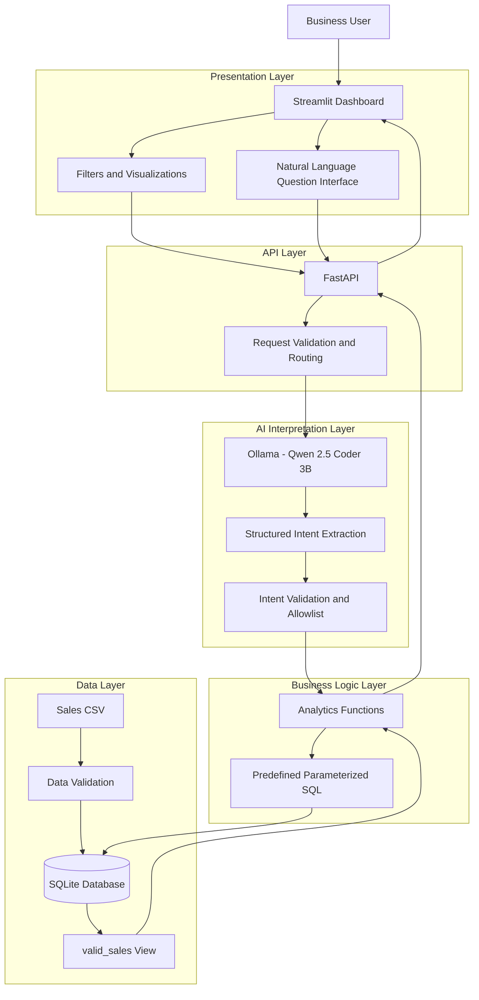
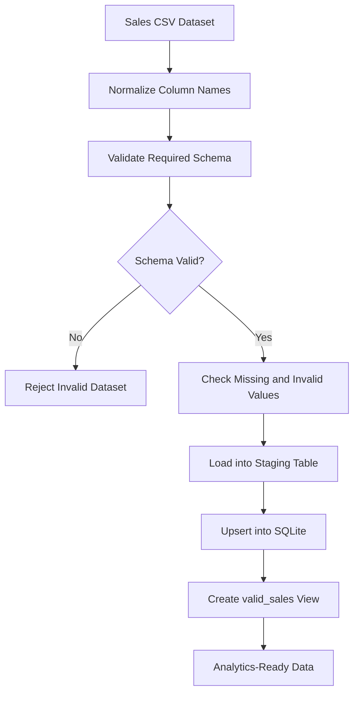
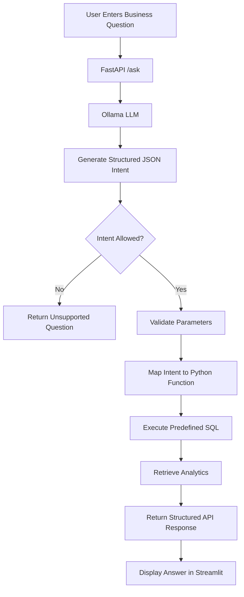
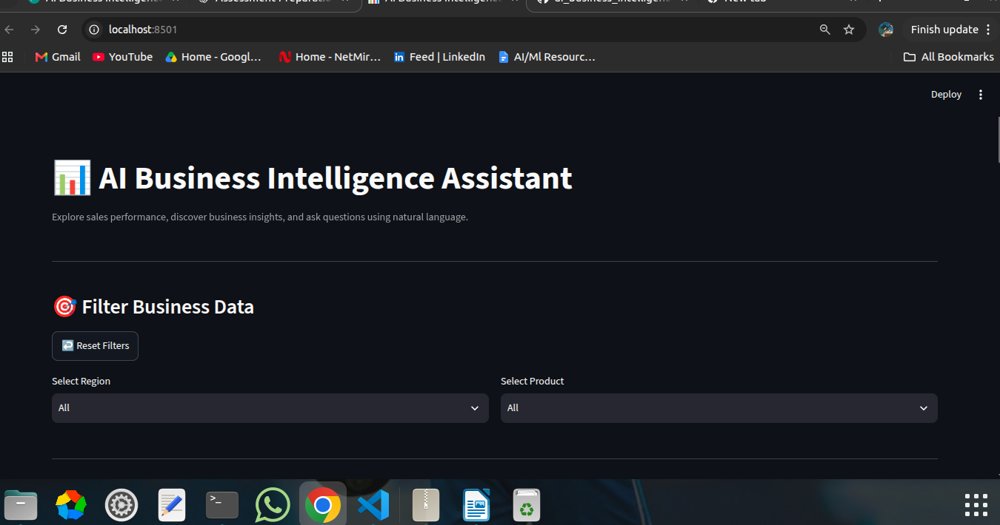
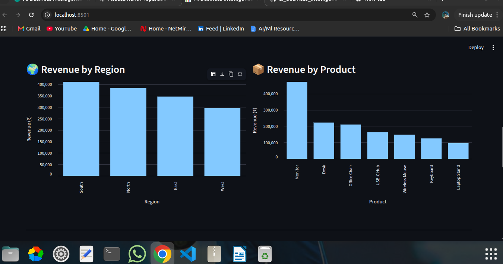
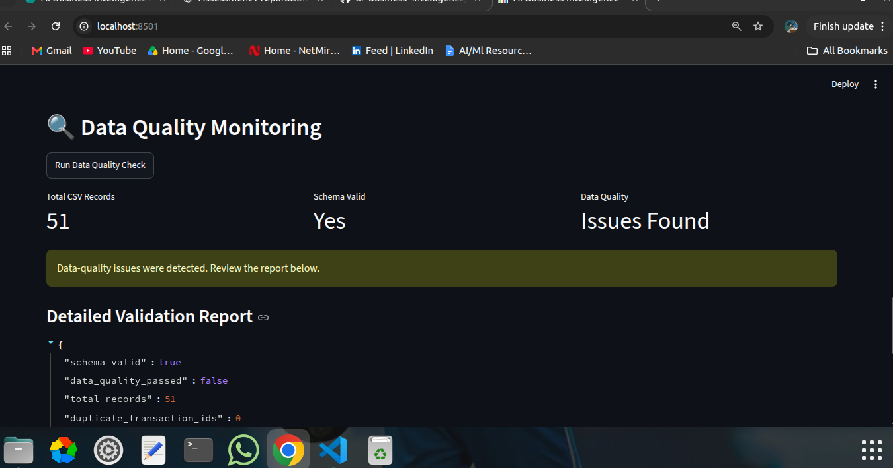

# Mini AI Business Intelligence Assistant

<p align="center">

**Turn raw sales data into actionable business insights using AI.**

A full-stack Business Intelligence application that combines data validation, SQL analytics, natural-language understanding, and interactive visualizations.

</p>

---

## 1. Overview

Businesses collect large amounts of transactional data, but extracting meaningful insights often requires writing SQL queries, understanding database schemas, or depending on technical teams.

This project addresses that problem by building an AI-powered Business Intelligence Assistant that allows users to explore sales performance through an interactive dashboard and ask business questions using natural language.

The application transforms raw CSV data into validated database records, calculates business metrics using predefined analytical queries, and uses a locally hosted Large Language Model (LLM) to understand user questions and route them to the appropriate analytical operations.

**The central design principle is that AI interprets the question, while the backend controls the data and calculations.**

### Key capabilities

- CSV ingestion and data quality validation.
- SQLite-based structured data storage.
- Revenue and sales performance analytics.
- Product, region, and monthly revenue analysis.
- Dynamic region and product filtering.
- Natural-language business question answering.
- Locally hosted LLM integration using Ollama.
- REST API built with FastAPI.
- Interactive dashboard built with Streamlit.
- Automated testing using Pytest.

---

## 2. The Business Problem

Traditional business intelligence workflows often involve several challenges:

| Problem | Why it matters | Our approach |
|---|---|---|
| Raw, unvalidated CSV data | Incorrect or incomplete records can distort reports | Validate data before using it for analytics |
| Manual SQL queries | Non-technical users may struggle to retrieve insights | Natural-language question interface |
| Inconsistent calculations | Different reports may calculate revenue differently | Centralized analytics functions |
| Difficult performance comparisons | Identifying trends across products and regions takes time | Aggregated SQL analytics and charts |
| Untrusted AI-generated queries | Arbitrary SQL can introduce security risks | Structured intent interpretation and predefined queries |
| Limited visibility into data issues | Users may not know why records were excluded | Data quality monitoring endpoint and dashboard |

### Example business questions

A business user should be able to ask:

- What is the total revenue generated?
- Which product generates the highest revenue?
- Which region performs best?
- Show the monthly revenue trend.
- Compare January and February revenue.

Instead of requiring users to write SQL, the application interprets the question and retrieves the corresponding business metric.

---

## 3. System Architecture

The application follows a modular, layered architecture. Each component has a clear responsibility, separating data ingestion, validation, analytics, AI interpretation, API handling, and visualization.

### High-level architecture



### Data ingestion and preparation flow



### Natural-language question flow



### Architectural decisions

**Why separate AI interpretation from analytics?**

An LLM is useful for understanding natural language, but it should not be trusted to calculate financial metrics or execute arbitrary database commands.

For example, when a user asks:

> Which product has generated the highest revenue?

The model identifies the intent as `top_product`. The backend then invokes the predefined `get_top_product()` function.

This separation provides:

- Predictable analytical calculations.
- Controlled database access.
- Easier testing and debugging.
- Reduced risk from arbitrary AI-generated SQL.
- Independent improvement of the AI and analytics layers.

---

## 4. Technology Stack

| Layer | Technology | Responsibility |
|---|---|---|
| Language | Python | Application logic |
| Data processing | Pandas | CSV processing and validation |
| Database | SQLite | Persistent structured storage |
| Backend | FastAPI | REST API and request handling |
| AI integration | Ollama | Local LLM execution |
| LLM | Qwen 2.5 Coder 3B | Natural-language interpretation |
| Frontend | Streamlit | Interactive dashboard |
| Visualization | Altair | Analytical charts |
| Testing | Pytest | Automated validation |
| API testing | FastAPI TestClient | Endpoint testing |

The LLM runs locally through Ollama rather than relying on a paid external LLM API.

---

## 5. Data Engineering and Data Quality

The application uses the supplied sales transaction CSV dataset.

### Dataset overview

| Metric | Result |
|---|---:|
| Total input records | 51 |
| Distinct products | 7 |
| Duplicate transaction IDs | 0 |
| Invalid dates | 0 |
| Records with invalid quantity | 1 |
| Records with invalid price | 1 |
| Missing unit prices | 1 |
| Valid completed sales records | 48 |

### Data validation

The ingestion process checks:

1. **Schema validation:** Required columns must exist.
2. **Missing values:** Checks required transaction fields for missing values.
3. **Duplicate records:** Detects duplicate transaction IDs.
4. **Date validation:** Identifies invalid order dates.
5. **Quantity validation:** Detects invalid quantities, including zero or negative values.
6. **Price validation:** Identifies missing or invalid unit prices.
7. **Discount validation:** Checks discount values against valid sales amounts.

### Business rules

The analytics layer uses a `valid_sales` database view.

Only completed transactions with valid positive quantities and prices, and valid discount amounts, contribute to revenue analytics.

Revenue is calculated using:

\[
\text{Net Revenue} =
(\text{Quantity} \times \text{Unit Price}) - \text{Discount Amount}
\]

The application does not treat every CSV row as a valid sale.

For example:
- A returned transaction is excluded from completed sales analytics.
- A transaction with zero quantity is excluded.
- A transaction with a missing unit price is excluded.
- Invalid discount values must not contribute to revenue.

This ensures that the dashboard reports are based on valid sales records rather than blindly aggregating the entire CSV.

---

## 6. Analytics Engine

The analytics layer contains reusable Python functions that execute predefined SQL queries against the validated sales view.

### Implemented analytical operations

| Function | Purpose |
|---|---|
| `get_total_revenue()` | Calculates total net revenue |
| `get_top_product()` | Finds the highest-revenue product |
| `get_monthly_revenue()` | Calculates revenue grouped by month |
| `get_top_region()` | Finds the highest-revenue region |
| `compare_months()` | Compares revenue between two months |
| `get_dashboard_data()` | Retrieves dashboard metrics and chart data |

### Verified analytical results

The following results were obtained from the supplied dataset:

| Business metric | Result |
|---|---:|
| Total net revenue | ₹1,439,200 |
| Valid transactions | 48 |
| Average order value | ₹29,983.33 |
| Top-performing product | Monitor |
| Monitor revenue | ₹473,000 |
| Top-performing region | South |
| South region revenue | ₹411,200 |

### Monthly revenue

| Month | Revenue |
|---|---:|
| January | ₹210,250 |
| February | ₹234,600 |
| March | ₹223,900 |
| April | ₹240,700 |
| May | ₹318,500 |
| June | ₹211,250 |

These results can be reproduced by running the analytics functions against the supplied dataset.

### Dynamic dashboard filtering

The dashboard supports:

- Region-based filtering.
- Product-based filtering.
- Combined region and product filtering.
- Resetting filters.
- Empty-result handling.

For example, selecting:

`Region = South` and `Product = Monitor`

returns:

| Metric | Result |
|---|---:|
| Revenue | ₹94,500 |
| Transactions | 2 |
| Average order value | ₹47,250 |

The filters are implemented using parameterized SQL rather than inserting user input directly into query strings.

---

## 7. AI-Powered Business Question Answering

The application uses the locally hosted `qwen2.5-coder:3b` model through Ollama.

### How the AI interpreter works

The AI interpreter converts natural-language questions into structured JSON.

For example:

**Input:**

```text
Which product has generated the highest revenue?
```

**Expected structured interpretation:**

```json
{
  "intent": "top_product",
  "month1": null,
  "month2": null
}
```

The backend validates the returned intent against an allowlist.

Supported intents:

- `total_revenue`
- `top_product`
- `monthly_revenue`
- `top_region`
- `compare_months`
- `unknown`

The backend then maps the validated intent to its corresponding Python analytics function.

### Why not allow the LLM to generate SQL?

Allowing an LLM to generate and directly execute SQL introduces risks such as:

- Destructive queries.
- Invalid SQL.
- Unexpected table access.
- Incorrect aggregations.
- SQL injection or unsafe query construction.

This project uses a controlled alternative:

**Natural language → Structured intent → Validation → Predefined analytics function → Parameterized SQL → Result**

The model never receives unrestricted database execution privileges through the application.

This is a deliberate design choice prioritizing correctness, safety, and maintainability over unrestricted text-to-SQL functionality.

---

## 8. Edge Cases and Error Handling

The application addresses several data, analytics, and AI-related edge cases.

| Edge case | Expected application behavior |
|---|---|
| Missing required CSV column | Schema validation fails |
| Missing unit price | Record is not included in valid-sales analytics |
| Zero or invalid quantity | Record is excluded from valid-sales analytics |
| Returned transaction | Excluded from completed sales analytics |
| Duplicate transaction ID | Duplicate is detected during validation |
| Invalid date | Reported by data-quality validation |
| Invalid discount | Reported by data-quality validation and excluded by the analytics rules |
| Empty user question | Request validation rejects it |
| Unsupported natural-language question | Returns an unsupported-intent response |
| Invalid LLM intent | Rejected instead of being executed |
| LLM service unavailable | API handles the interpreter failure |
| Unknown region or product filter | Returns zero metrics and empty result collections |
| Combined filters with no matches | Returns an empty analytics result instead of failing |
| Repeated CSV loading | Uses an upsert strategy to avoid duplicating existing transaction IDs |
| User-provided filter values | Passed through parameterized SQL |

### Important data-handling behavior

The CSV loader uses a staging table and upserts records into the main transaction table.

Repeated loading of the same dataset was tested and resulted in 51 records rather than duplicate records.

The loader is an upsert-based ingestion process, not a full synchronization mechanism: records removed from a later CSV are not automatically deleted from the database.

---

## 9. REST API

The backend exposes analytical operations through FastAPI.

### Available endpoints

| Method | Endpoint | Description |
|---|---|---|
| GET | `/` | Application information |
| GET | `/health` | Health check |
| GET | `/analytics/revenue` | Total revenue |
| GET | `/analytics/top-product` | Highest-revenue product |
| GET | `/analytics/top-region` | Highest-revenue region |
| POST | `/ask` | Natural-language business question |
| GET | `/data-quality` | Dataset quality report |
| GET | `/dashboard` | Dashboard analytics with optional filters |

### Example API request

`POST /ask`

```json
{
  "question": "Which product has generated the highest revenue?"
}
```

The API interprets the question and returns a structured response containing the result.

### Interactive API documentation

After starting FastAPI, open:

`http://127.0.0.1:8000/docs`

FastAPI automatically provides interactive Swagger documentation.

---

## 10. Frontend and Visualization

The Streamlit application provides a simple interface for business users.

### Dashboard components

- Total revenue KPI.
- Valid transaction count.
- Average order value.
- Top-performing product.
- Monthly revenue trend.
- Revenue by region.
- Revenue by product.
- Interactive region and product filters.
- AI-powered business question interface.
- Data quality monitoring section.

The frontend communicates with the FastAPI backend rather than directly accessing the SQLite database.

This keeps the presentation layer separate from business logic and data access.

---

## 11. Testing Strategy

Automated testing is performed using Pytest and FastAPI's TestClient.

The current test suite contains eight tests.

| Test | What it verifies |
|---|---|
| Total revenue | Correct revenue aggregation |
| Top product | Correct product ranking |
| Monthly revenue | Correct monthly aggregation |
| Top region | Correct regional ranking |
| Month comparison | Correct revenue difference and percentage |
| CSV validation | Dataset schema, record count, and duplicate detection |
| AI question API | Correct handling of a supported analytical intent |
| Unsupported question API | Graceful handling of an unknown intent |

### Run the tests

```bash
python -m pytest -v
```

**Latest verified result:**

```text
8 passed, 1 warning
```

The warning was a dependency deprecation warning and did not cause any test failures.

---

## 12. Installation and Execution

### Prerequisites

- Python 3.10+
- Ollama
- Git

### Step 1: Clone the repository

```bash
git clone <YOUR_GITHUB_REPOSITORY_URL>
cd ai-business-intelligence
```

### Step 2: Create a virtual environment

```bash
python3 -m venv venv
source venv/bin/activate
```

### Step 3: Install dependencies

```bash
pip install -r requirements.txt
```

### Step 4: Start Ollama and download the model

```bash
ollama pull qwen2.5-coder:3b
```

Ensure the Ollama service is running before sending AI questions.

### Step 5: Initialize the database

From the project root:

```bash
python -c "from backend.database import create_database, load_csv, create_analytics_view; create_database(); print(load_csv()); create_analytics_view()"
```

This creates the SQLite database, loads the CSV, and prepares the analytics view.

### Step 6: Start the backend

```bash
uvicorn backend.main:app --reload
```

Backend:

`http://127.0.0.1:8000`

### Step 7: Start the frontend

Open another terminal:

```bash
source venv/bin/activate
streamlit run frontend/app.py
```

The Streamlit application will display its local URL in the terminal.

---

## 13. Project Structure

```text
ai-business-intelligence/
│
├── backend/
│   ├── __init__.py
│   ├── database.py
│   ├── analytics.py
│   ├── ai_interpreter.py
│   └── main.py
│
├── frontend/
│   └── app.py
│
├── tests/
│   └── test_analytics.py
│
├── data/
│   └── ai_bi_assistant_sales_data - GET.csv
│
├── requirements.txt
├── README.md
└── AI_USAGE.md
```

### Module responsibilities

| File | Responsibility |
|---|---|
| `database.py` | Database creation, CSV loading, data validation, and analytics view |
| `analytics.py` | SQL-based business metrics and dashboard aggregations |
| `ai_interpreter.py` | LLM integration, structured intent extraction, and intent validation |
| `main.py` | FastAPI application, API endpoints, and request handling |
| `app.py` | Streamlit dashboard and AI question interface |
| `test_analytics.py` | Automated analytics and API tests |

---

## 14. Current Limitations

The project deliberately focuses on a controlled set of business analytics rather than unrestricted conversational analytics.

Current limitations include:

- The assistant supports predefined analytical intents.
- Only the supplied sales dataset is currently integrated.
- The AI assistant does not automatically apply dashboard filters to natural-language questions.
- Complex multi-step analytical questions are not yet supported.
- Follow-up conversational memory is not implemented.
- The ingestion process uses upserts but does not remove database records absent from a newer CSV.

### Future improvements

- Filter-aware natural-language queries.
- Multi-turn conversational analytics.
- More business metrics and analytical operations.
- Support for multiple datasets and databases.
- More extensive edge-case and integration tests.
- Authentication and role-based access control.
- Deployment using Docker and cloud infrastructure.

---

## 15. Engineering Highlights

This project demonstrates an end-to-end workflow involving:

- Data ingestion and validation.
- Relational database design.
- SQL aggregation and analytical query development.
- Backend API development.
- Local LLM integration.
- Structured AI output validation.
- Safe execution of predefined analytical operations.
- Interactive data visualization.
- Automated testing and error handling.

**The key engineering decision is separating probabilistic AI interpretation from deterministic business logic.** This makes the system easier to validate, debug, test, and extend.

---

## 16. Conclusion

The Mini AI Business Intelligence Assistant demonstrates how Large Language Models can make structured business analytics more accessible without surrendering control of the underlying data operations.

By combining a validated data pipeline, SQLite, predefined SQL analytics, FastAPI, Ollama, and Streamlit, the project provides a complete workflow from raw transactional data to interactive business insights.

## Application Screenshots

### Main Dashboard


### Analytics


### AI Business Assistant


### Data Quality Monitoring
